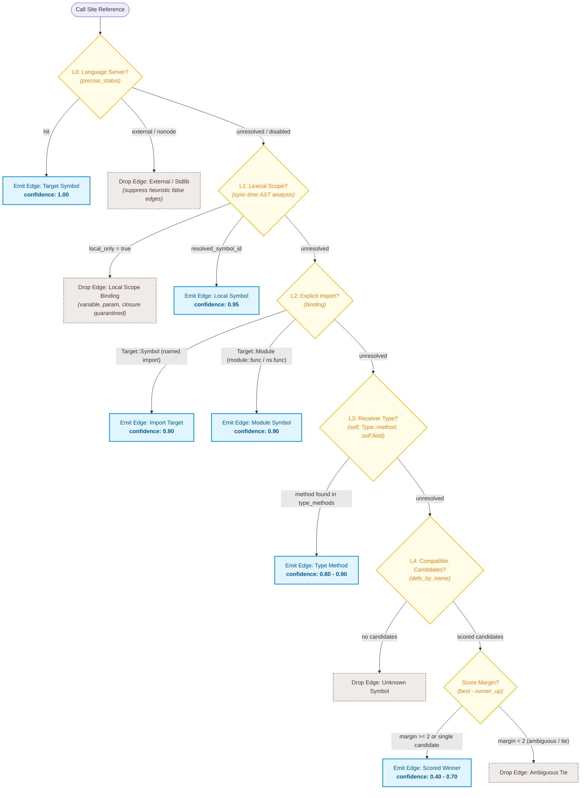

# codebase-recall

[Semantic model migration](docs/MIGRATION-SEMANTIC-MODEL.md) · [Getting started](docs/GETTING-STARTED.md) · [Usage guide](docs/USAGE.md) · [MCP setup and tools](docs/MCP.md)

Version 0.9.1 includes semantic/hybrid search, C/C++ analysis, selective LSP verification, and fixes duplicate-symbol crashes in recovered headers. Read the [embedding guide](docs/EMBEDDINGS.md) and [0.9.1 upgrade notes](docs/MIGRATION-0.9.1.md). The [0.9 migration guide](docs/MIGRATION-0.9.md) still applies to older integrations. JSON examples below show the `data` payload unless an envelope is shown.

> **High-performance CLI codebase context dumper for LLMs and AST-based code relation grapher.**

`codebase-recall` (`code-rcl`) is a command-line tool built with Rust 🦀 designed for two primary developer workflows:

1. **Context Bundling for LLMs:** Scan your directory structure and bundle your codebase—or a focused, dependency-aware slice of it—into a clean, well-structured Markdown document ready for LLMs (ChatGPT, Claude, Gemini, DeepSeek).
2. **Code Relation Graph & Architecture Visualization:** Parse ASTs across multiple languages (Rust, Go, JS/TS, Python, Java, Kotlin, Vue, Svelte) to discover definitions, imports, and cross-file calls. Visualize interactions in real-time in an interactive browser UI or export to self-contained HTML, Graphviz DOT, or JSON.

---

## Demo


---

## Semantic code search

```sh
code-rcl embeddings setup
code-rcl embeddings sync
code-rcl search "where requests are cancelled" --semantic
code-rcl search "cancel request" --hybrid
```

Model download is explicit. Normal semantic/hybrid searches refresh pending
embeddings after edits; explicit indexing is also available. Lexical search
remains the default while the automatic feature pipeline is quality-gated.
Inspect embedding freshness and coverage before drawing conclusions. See
[setup, configuration and troubleshooting](docs/EMBEDDINGS.md).
See [search consistency and automatic retrieval evaluation](docs/AUTOMATIC-SEARCH.md).

C17/C23 and C++23 source analysis is available, with optional clangd precise
resolution using the project's compilation database. See [C/C++ setup and limits](docs/C-CPLUSPLUS.md).

## Key Features

### 📦 Codebase Context Dumper (`dump`)

- **Full & Targeted Dumps:**
  - **Full Dump:** Pack the entire repository with directory trees and filtered source contents.
  - **Targeted / Relation-Aware Dump (`-r / --relation`):** Provide a target symbol or file; `code-rcl` traverses the dependency graph up to `--depth <N>` and dumps *only* connected and relevant files—saving prompt tokens and eliminating hallucination noise.
- **Smart Filtering:**
  - Automatically respects `.gitignore` rules and ignores hidden directories (`.git/`, `.cache/`, etc.).
  - Skips binary files, media assets (`.png`, `.webp`, `.pdf`, etc.), lockfiles (`Cargo.lock`, `package-lock.json`, `pnpm-lock.yaml`, `bun.lockb`, etc.), minified bundles (`.min.js`, `.chunk.js`), and sensitive environment files (`.env*`).
- **Safe Dynamic Markdown Fencing:** Detects the maximum backtick streak in file contents and dynamically expands markdown fences (e.g. ` ```` ` or ` ````` `) to prevent nested markdown from breaking document formatting.
- **Size Limits & Path Normalization:** Configurable per-file size limit (default: 50 KB) and automated path separator normalization across OS platforms.

### 🕸️ Code Relation Graph (`graph` & `serve`)

- **Multi-Language AST Parsing:** Powered by tree-sitter for **Rust**, **Go**, **JavaScript/JSX**, **TypeScript/TSX**, **Python**, **Java**, **Kotlin**, and Single-File Components (**Vue**, **Svelte**).
- **Multi-Tier Resolution:** Tracks symbols (functions, structs, classes, enums, methods), imports, and call references across files with confidence scoring.
- **Incremental bkndb Caching:** Stores file hashes (Blake3) and AST entities in `.code-rcl/cache.bkndb`, an embedded single-file database. Every normal sync hashes eligible contents; only changed contents are reparsed.
- **Interactive Browser Viewer (`serve`):**
  - Instant local visualization powered by vendored d3-force simulation (smooth zoom, pan, and drag).
  - Toggle edge kinds (`imports`, `calls`, `references`).
  - Interactive search filtering, node isolation, cluster expansion/collapsing, and press-and-hold node spotlighting.
  - Interactive BFS depth adjuster directly inside the web UI.
  - **Zero Background Footprint:** Uses a lightweight EventSource heartbeat; the local server automatically terminates when you close your browser tab.
- **Export Formats (`graph`):** Standalone zero-dependency HTML, Graphviz `.dot`, and structured JSON (`version: 3`).

---

## Installation

### Prebuilt Binaries

Release installers fetch published artifacts. To use unpublished 0.9.1 changes in this checkout, build/install from source and verify `code-rcl --version`.

#### macOS / Linux (Shell Script)

```sh
curl --proto '=https' --tlsv1.2 -LsSf https://github.com/BknOrg/codebase-recall/releases/latest/download/codebase-recall-installer.sh | sh
```

#### Windows (PowerShell)

```powershell
irm https://github.com/BknOrg/codebase-recall/releases/latest/download/codebase-recall-installer.ps1 | iex
```

### Install via Cargo (crates.io)

Ensure you have Rust and Cargo installed:

```bash
cargo install codebase-recall
```

### Build from Source

```bash
git clone https://github.com/BknOrg/codebase-recall.git
cd codebase-recall
cargo build --release
cargo install --path .
```

The compiled binary is available as `code-rcl`.

---

## Search modes and structured output

```sh
code-rcl search CacheDb --match-mode exact --json
code-rcl search Cache --match-mode prefix
code-rcl sync --json
```

CLI JSON uses `schema_version`, `status`, `data`, and `metadata`. Existing consumers must read former root-level fields/arrays from `data`. See [the usage guide](docs/USAGE.md) for examples and [migration](docs/MIGRATION-0.9.md) for compatibility changes.

## Subcommands Overview

`code-rcl` is organized into subcommands:

| Command | Description |
| :--- | :--- |
| `code-rcl dump` | Bundle the codebase (or a symbol's neighborhood) into a single Markdown file for LLM context. |
| `code-rcl digest` | Generate an architecture outline and public API signature digest without function bodies. |
| `code-rcl impact` | Analyze blast radius and downstream/upstream callers affected by modifying a symbol, or by your uncommitted changes (`--diff`). |
| `code-rcl path` | Find the shortest chain of calls/imports connecting one symbol to another. |
| `code-rcl explain` | Summarize one symbol: signature, docs, members, direct callers/callees, risk flags. |
| `code-rcl report` | Architecture report: core hubs, subsystems (communities), bridges, suggested questions. Kept fresh in `.code-rcl/REPORT.md` by `sync`. |
| `code-rcl init` | Initialize `.code-rcl/` (`cache.bkndb` + `config.toml`) and add it to `.git/info/exclude`. |
| `code-rcl sync` | Incrementally parse changed source files into the graph cache. |
| `code-rcl graph` | Auto-sync, then export the relation graph to file(s) (`html`, `json`, `dot`). |
| `code-rcl serve` | Auto-sync, then host an interactive relation graph in the browser; exits when the tab closes. |
| `code-rcl mcp` | Run Model Context Protocol (MCP) server over stdio for AI agent integration. |
| `code-rcl setup` | Self-install AI agent skill and auto-configure MCP servers (Gemini/Antigravity, Claude Code). |

> **Interactive Help:** You can view parameter options and real usage examples for any command with `code-rcl <cmd> help` (e.g. `code-rcl dump help`, `code-rcl digest help`).

---

## Usage — `dump` (LLM Context Generator)

### 1. Standard Full Dump

Scan the repository and produce a comprehensive `codebase-context.md`:

```bash
# Scan current directory -> codebase-context.md
code-rcl dump

# Scan specific project directory and specify output filename
code-rcl dump ./path/to/project -o context.md

# Increase per-file size limit to 100 KB
code-rcl dump . --max-size-kb 100 -o full-context.md
```

### 2. Relation-Aware / Targeted Dump

When working with large codebases, dumping everything can exceed token context windows or degrade LLM reasoning. Use `--relation` (`-r`) to extract only the target file/symbol and its connected dependency neighborhood:

```bash
# Dump only files connected to `build_graph` within 2 degrees of relationship
code-rcl dump -r build_graph

# Dump files connected to a specific module/file with a custom depth of 3
code-rcl dump -r src/commands/dump.rs --depth 3 -o dump-feature-context.md

# Skip auto-sync if cache is already fresh
code-rcl dump -r App --no-sync
```

### `dump` Options

| Flag / Option | Short | Default | Description |
| :--- | :--- | :--- | :--- |
| `[PATH]` | - | `.` | Target project directory path to scan |
| `-o, --output <PATH>` | `-o` | `codebase-context.md` | Path or name of output Markdown file (auto-appends `.md` if omitted) |
| `--max-size-kb <N>` | - | `50` | Maximum file size (in KB) for content extraction |
| `-r, --relation <NAME>` | `-r` | `None` | Restrict dump to the target symbol/file and its connected dependency graph |
| `--depth <N>` | - | `2` | BFS traversal depth when using `--relation` |
| `--no-sync` | - | `false` | Do not re-sync graph cache before building targeted relation dump |

### Output Markdown Structure

````markdown
> **Targeted dump**: focused on `build_graph` with depth 2.

# Directory Tree

```text
├── Cargo.toml
└── src
    ├── cli.rs
    ├── commands
    │   └── graph.rs
    └── main.rs
```

---

# Source Files

## File: `src/commands/graph.rs`

```rs
// Extracted source code with dynamic fence backtick handling...
```
````

---

## Usage — Code Relation Graph (`init`, `sync`, `graph`, `serve`)

### Quick Setup

```bash
# 1. Initialize .code-rcl/ in your project (creates cache.bkndb and config.toml)
code-rcl init

# 2. Parse source files into cache (Blake3-based incremental indexing)
code-rcl sync
```

### `code-rcl graph` (File Output)

Generates static graph visualizations in standalone HTML, DOT, or JSON format:

```bash
# Default: auto-syncs and outputs .code-rcl/code-graph.html
code-rcl graph

# Generate HTML, JSON, and DOT files simultaneously
code-rcl graph --format html,json,dot -o build/graph

# File-level dependency graph only (imports between files)
code-rcl graph --scope file --min-confidence 0.7

# Focus on a specific symbol and its immediate neighborhood
code-rcl graph --focus App --depth 2

# Limit graph nodes to prevent cluttered views
code-rcl graph --max-nodes 2000
```

#### `graph` Options

| Flag | Default | Description |
| :--- | :--- | :--- |
| `--project <PATH>` | `.` | Project directory (cache stored in `<project>/.code-rcl/`) |
| `--format <LIST>` | `html` | Comma-separated output formats: `html`, `json`, `dot` |
| `-o, --output <PATH>` | `.code-rcl/code-graph.<ext>` | Output file or path stem when requesting multiple formats |
| `--scope <MODE>` | `both` | Graph scope: `file` (imports only), `symbol`, or `both` (layered) |
| `--kinds <LIST>` | `imports,calls,contains,implements` | Edge kinds to include (`imports`, `calls`, `contains`, `implements`, `references`) |
| `--path <GLOB>` | `None` | Filter source files by glob pattern |
| `--focus <NAME>` | `None` | Restrict graph to the neighborhood of a symbol or file |
| `--depth <N>` | `2` | BFS traversal depth around `--focus` |
| `--min-confidence <F>` | `0.4` | Filter out resolved edges below this confidence score `[0.0 - 1.0]` |
| `--include-external` | `false` | Include external dependencies (npm, PyPI, crates.io packages) |
| `--max-nodes <N>` | `4000` | Node cap; drops lowest-degree symbols if exceeded (`0` to disable) |
| `--no-sync` | `false` | Render directly from cache without checking/re-parsing modified files |
| `--precise` | `false` | Resolve calls through real language servers ([see below](#compiler-grade-accuracy---precise)) |

---

### `code-rcl serve` (Interactive Browser Viewer)

`code-rcl serve` resolves the graph and hosts an interactive UI on a local HTTP server (`127.0.0.1`), automatically opening your default browser.

```bash
# Build, sync, and launch the interactive viewer on a free port
code-rcl serve

# Pin port and do not launch browser automatically
code-rcl serve --port 8080 --no-open

# Apply filters directly when serving
code-rcl serve --scope symbol --focus handle_request --depth 3
```

#### How `serve` Works

- **Self-Terminating / Zero Background Leak:** An active browser tab maintains an `EventSource` connection (`/live`). Closing the browser tab drops the connection, causing the server to cleanly exit within 2 seconds.
- **Ctrl-C:** Instantly halts the server.
- **No External Network Dependencies:** D3.js and frontend styles are bundled inside the binary; no external CDNs or network connections are made.

#### Browser UI Features

- **Force Simulation:** Real-time physics layout with smooth zooming, panning, and node dragging.
- **Dynamic Filtering:** Checkbox controls for `imports`, `calls`, and `references`.
- **Search & Isolate:** Real-time search bar with instant node filtering and single-click node isolation.
- **Live Depth Controls:** Adjust BFS depth (`+` / `-`) directly from the browser navigation bar.
- **Node Spotlighting:** Long-press any node to spotlight its immediate connections while dimming the rest of the graph.

---

## Usage — `digest` (Architecture Outline & Public API Digest)

Generate a high-level architectural skeleton and public API index. `digest` strips function bodies (`{ ... }`), preserving types, interfaces, methods, and exported signatures to reduce source-context size while keeping declarations visible. It also detects **Core Architecture Hubs** (the highest-degree connected symbols) to highlight the central pillars of the codebase.

### Examples

```bash
# 1. Generate architecture digest for current project to stdout
code-rcl digest

# 2. Save digest to a markdown file (-o / --output, alias: -f)
code-rcl digest -o architecture.md

# 3. Digest a specific sub-directory or sub-module
code-rcl digest src/analysis

# 4. Include private and internal symbols
code-rcl digest --all

# 5. Output structured JSON for automated tooling
code-rcl digest --json
```

### `digest` Options

| Flag / Option | Short | Default | Description |
| :--- | :--- | :--- | :--- |
| `[PATH]` | - | `.` | Target project directory or sub-path to outline |
| `-o, --output <PATH>` | `-o` | *stdout* | Output file path for the generated markdown digest |
| `--all` | - | `false` | Include private/internal functions and types (default: public only) |
| `--json` | - | `false` | Output result as structured JSON instead of Markdown |
| `--no-sync` | - | `false` | Skip auto-syncing changed files before generating digest |

---

## Usage — `impact` (Blast Radius & Impact Analysis)

Analyze the blast radius of modifying a function, class, or module. `impact` traverses caller/callee relationships (`calls`, `imports`, and `references` by default) to inspect potential effects. Results depend on parser/resolver coverage, confidence, and configured limits.

### Examples

```bash
# 1. Inspect who calls or imports `decorate` (terminal ASCII tree)
code-rcl impact decorate

# 2. Increase search depth to 3 hops
code-rcl impact decorate --depth 3

# 3. Output as structured JSON for CI/CD or PR review
code-rcl impact decorate --json

# 4. Blast radius of everything you changed since HEAD (no symbol name needed)
code-rcl impact --diff

# 5. How does one symbol reach another? / summarize one symbol
code-rcl path main decorate
code-rcl explain decorate
```

Items are annotated with risk flags: `⚠ public` (exported API), `⚠ low-conf` (ambiguous resolution that may hide dynamic dispatch) and `⚠ cross-module (<subsystem>)` (the item lives in a different subsystem than the target; see [`report`](#usage--report-architecture-overview--subsystems)). Without detected subsystems it falls back to "different top-level directory".

### Example Terminal Output

```text
══════════════════════════════════════════════════════════════════
  IMPACT ANALYSIS: decorate  [function]
  util.rs
──────────────────────────────────────────────────────────────────
  Direct callers : 1      Direct callees : 0
  Total affected : 2 symbols across 2 file(s)
  Max depth      : 2
  Risk flags     : 1 item(s) touch public API, low-confidence edges, or cross module boundaries
══════════════════════════════════════════════════════════════════

▲ UPSTREAM CALLERS
  └── ○ greet  [calls → function]  util.rs:2  (conf 0.95)  ⚠ public
      │ decorate(name)
      └── ◆ main  [calls → function]  main.rs:4  (conf 0.90)
          │ let msg = util::greet("world");

▼ DOWNSTREAM CALLEES
  (no outgoing calls found)
```

### `impact` Options

| Flag / Option | Short | Default | Description |
| :--- | :--- | :--- | :--- |
| `<TARGET>` | - | *required* unless `--diff` | Target symbol name or file path to analyze |
| `--diff` | - | `false` | Use symbols touched by uncommitted git changes (vs `HEAD`) as targets; excludes `<TARGET>` |
| `--direction <DIR>` | - | `both` | `both`, `reverse` (callers only) or `forward` (callees only) |
| `--project <PATH>` | - | `.` | Target project directory |
| `--depth <N>` | - | `2` | Max reverse traversal depth (hop count) |
| `--kinds <KINDS>` | - | `calls,imports` | Edge kinds to traverse in reverse, comma-separated |
| `--json` | - | `false` | Output result as JSON instead of ASCII tree |
| `--no-sync` | - | `false` | Skip auto-syncing changed files before analyzing |
| `--precise` | - | `false` | Use compiler-grade LSP edges (see [`--precise`](#compiler-grade-accuracy---precise)) |

---

## Usage — `report` (Architecture Overview & Subsystems)

```bash
code-rcl report            # print the Markdown report
code-rcl report --write    # write .code-rcl/REPORT.md
code-rcl report -o overview --json
```

A one-page overview: summary, **core hubs**, **subsystems**, **bridges**, and **suggested questions** (ready-to-run `impact` / `path` / `explain` commands built from the project's own hubs).

- **Subsystems** are groups of files that depend on each other far more than on the rest, detected without an LLM by Louvain modularity optimisation over file-level `imports` / `calls` / `references` links (symbols inherit their file's subsystem). The result is deterministic; each subsystem is named after the one or two directories holding most of its files and reports its key files and *cohesion* (share of its links that stay inside it).
- **Bridges** are files with links into other subsystems, ranked by how many they touch.
- **Always fresh:** `code-rcl sync` rewrites `.code-rcl/REPORT.md` when files were added, changed or removed (never when nothing changed; failures only warn). Skip with `sync --no-report`. With the git hook from `setup --git-hook`, the report follows every commit.
- The same subsystems appear as `community` on graph nodes (`--format json`), in the `impact` / `explain` output, and as a **"color by subsystem"** toggle in the HTML viewer.

| Flag | Default | Description |
| :--- | :--- | :--- |
| `--project <PATH>` | `.` | Target project directory |
| `--write` | `false` | Write to `.code-rcl/REPORT.md` |
| `-o, --output <PATH>` | - | Also write here (`.md`, or `.json` with `--json`, is added if missing) |
| `--json` | `false` | Structured JSON instead of Markdown |
| `--no-sync` | `false` | Skip auto-syncing changed files first |

---

## Language Support

| Language | Extensions | Parser Engine | Features Detected |
| :--- | :--- | :--- | :--- |
| **Rust** | `.rs` | Tree-sitter | Functions, structs, enums, traits, methods, macros, `use` imports, calls |
| **JavaScript** | `.js`, `.mjs`, `.cjs` | Tree-sitter | Functions, classes, methods, ESM/CJS imports, calls |
| **JSX** | `.jsx` | Tree-sitter | Components, functions, hooks, imports, JSX references |
| **TypeScript** | `.ts`, `.mts`, `.cts` | Tree-sitter | Interfaces, types, classes, functions, modules, imports |
| **TSX** | `.tsx` | Tree-sitter | TS types, React components, hooks, imports, calls |
| **Python** | `.py`, `.pyi` | Tree-sitter | Functions, classes, methods, `import` / `from ... import`, calls |
| **Java** | `.java` | Tree-sitter | Classes, interfaces, enums, records, methods, `import` (incl. `static` / `.*`), calls |
| **Kotlin** | `.kt`, `.kts` | Tree-sitter | Classes, objects, top-level & member functions (incl. `@Composable`), properties, `import` (incl. `as` / `.*`), calls |
| **Go** | `.go` | Tree-sitter | Functions, methods (with receiver types), structs, interfaces, type aliases, `import`, calls |
| **Vue** | `.vue` | SFC Extractor + TS/JS | `<script>` & `<script setup>` symbols, imports, components |
| **Svelte** | `.svelte` | SFC Extractor + TS/JS | `<script>` symbols, imports, reactive calls |

## Resolution Semantics, Accuracy & Limitations

`code-rcl` implements a tiered reference resolver. By default, it runs a fast AST-based heuristic engine that requires no compilation or external toolchain. For exact resolution, `--precise` integrates Language Server Protocol (LSP) backends to compute compiler-grade definitions.

### Resolution Pipeline (L0 – L4)

References are resolved through a 5-tier pipeline ordered by confidence:

1. **L0 — Compiler Backend (`--precise`):** Queries language servers (`rust-analyzer`, `pyright`, `typescript-language-server`, `jdtls`, etc.) via JSON-RPC (`confidence = 1.0`). References resolving to external packages or standard libraries produce no edge, preventing false cross-file links.
2. **L1 — Lexical Scope:** Resolves same-file definitions during the AST walk (`confidence = 0.95`). Identifiers bound to local variables, parameters, or closures are tagged `local_only = true` and quarantined from cross-file matching.
3. **L2 — Explicit Imports & Namespaces:** Resolves qualified paths (`module::func()`) and explicit symbol imports (`use crate::worker::Retry`) (`confidence = 0.90`).
4. **L3 — Receiver Type Deduction:** Resolves calls on `self`, `this`, `Type::method`, and struct field access chains (`self.worker.run()`) against the project's indexed type definitions (`confidence = 0.80 - 0.90`).
5. **L4 — Scored Disambiguation:** Fallback when the receiver type is unannotated or absent from local definitions. Candidates sharing the callee name are scored by import reachability (+3), export visibility (+2), parameter arity match (+1 to +2), and directory proximity (+1). To prevent false positives, an edge is emitted only if the score margin between the top candidate and runner-up is at least 2 (`margin >= 2`). Exact ties emit no edge.



### Empirical Verification & Accuracy Benchmarks

Resolver behavior is verified by integration test suites in `tests/resolve_accuracy.rs`. Every fixture is an executable program instrumented to verify runtime execution traces (`cargo run`), paired with database assertions on cache tables (`refs.precise_status`, `refs.local_only`):

| Fixture | Target Scenario | Heuristic (Recall / Prec.) | Precise (Recall / Prec.) | Resolution Behavior |
| :--- | :--- | :---: | :---: | :--- |
| `resolve_app` | Cross-file method & bare module path | **100%** / **100%** | *N/A* | Resolved via L2 imports and L3 receiver fields. |
| `local_shadow_app` | Local closure shadowing same-named function | **100%** / **100%** | *N/A* | L1 marks closure call `local_only`, avoiding false cross-file edge. |
| `rust_precise_app` | Inferred constructor return (`let h = Real::new()`) | 80% / 80% | **100%** / **100%** | Heuristics resolve to imported decoy; `--precise` infers return type. |
| `python_precise_app` | Dynamic method polymorphism | 75% / 75% | **100%** / **100%** | Heuristic misses unannotated instance; Pyright resolves runtime class. |
| `generic_type_app` | Standard library `Vec<T>::push` vs custom `push` | 100% / 67% | **100%** / **100%** | Heuristics match single workspace `push`; `--precise` marks `Vec` call external. |

### Known Limitations

- **Standard Library Method Collisions (Heuristic Mode):** Heuristic mode indexes only files within the workspace. When calling common methods (`push`, `len`, `get`) on standard library types (`Vec`, `HashMap`, `Option`), L3 cannot deduce external receiver types and delegates to L4. If only one method with that name exists in the workspace, L4 scores it as an uncontested candidate. Use `--precise` to suppress external library calls.
- **Generic Type AST Normalization:** `impl<T> Buffer<T>` is indexed with its generic parameters. When called from a site typed as `Buffer<String>`, string-equality checks in L3 may fail to pair the receiver, deferring resolution to L4.
- **Dynamic Language Metaprogramming:** Dynamic dispatch (`getattr`, monkey patching, runtime decorators, eval) cannot be resolved statically from AST alone.
- **Build System Prerequisites for `--precise`:** Compiler-grade backends require valid project manifests (`Cargo.toml`, `tsconfig.json`, `pom.xml`, `build.gradle`). Without a project model, language servers degrade to syntax-only inspection.

---

## Compiler-Grade Accuracy (`--precise`)

When exact call resolution is critical, `--precise` queries the real language server for each language where a name is defined, and stores that answer as the top resolution layer (L0):

```bash
# Resolve through installed language servers
code-rcl sync --precise

# Only one language, with custom timeout
code-rcl sync --precise --language rust --precise-timeout 30

# Re-ask about every file (edits can change how other files resolve)
code-rcl sync --precise --precise-full

# Export graph with compiler precision
code-rcl graph --precise
```

### Supported Language Servers

Nothing is bundled. Install the servers for your languages; a missing server is reported with its install command and the precise request fails. Explicit `--allow-heuristic-fallback` permits partial heuristic results with warnings.

| Language | Server | Install Command | Override Variable |
| :--- | :--- | :--- | :--- |
| **Rust** | `rust-analyzer` | `rustup component add rust-analyzer` | `CODE_RCL_LSP_RUST` |
| **Python** | `pyright-langserver` | `npm install -g pyright` | `CODE_RCL_LSP_PYTHON` |
| **TypeScript** | `typescript-language-server` | `npm install -g typescript-language-server typescript` | `CODE_RCL_LSP_TYPESCRIPT` |
| **JavaScript** | `typescript-language-server` | `npm install -g typescript-language-server typescript` | `CODE_RCL_LSP_JAVASCRIPT` |
| **Java** | `jdtls` (Eclipse JDT LS) | [eclipse.jdt.ls releases](https://github.com/eclipse-jdtls/eclipse.jdt.ls) (needs JDK 17+) | `CODE_RCL_LSP_JAVA` |
| **Kotlin** | `intellij-server` (JetBrains, default) or `kotlin-language-server` (fwcd, `server = "fwcd"`) | [Kotlin/kotlin-lsp](https://github.com/Kotlin/kotlin-lsp), [kotlin-language-server releases](https://github.com/fwcd/kotlin-language-server/releases) | `CODE_RCL_LSP_KOTLIN` |
| **Go** | `gopls` | `go install golang.org/x/tools/gopls@latest` | `CODE_RCL_LSP_GO` |

Per-project defaults for these flags, and the Kotlin server choice (`[precise.kotlin] server`), live in `.code-rcl/config.toml`; see [docs/CONFIGURATION.md](docs/CONFIGURATION.md).

#### `sync --precise` Options

| Flag | Default | Description |
| :--- | :--- | :--- |
| `--precise` | `false` | Resolve references through the real language servers |
| `--precise-full` | `false` | Re-ask about every file, not just the ones with no answer yet |
| `--precise-timeout <SECONDS>` | `15` | Initialization/request budget; also bounds the indexing wait |
| `--allow-heuristic-fallback` | `false` | With `--precise`, permit partial heuristic results when LSP fails |

---

## JSON Schema (`--format json`, `version: 2`)

When exporting with `code-rcl graph --format json`, the following structure is inside the result envelope's `data` field. Read nodes as `result.data.nodes`; the envelope has `schema_version: 2`. See [JSON results](docs/USAGE.md#json-results).

```jsonc
{
  "version": 2,
  "root": "/path/to/project",
  "generated_at": 1730000000,
  "communities": [
    { "id": 0, "label": "src/commands", "size": 12 }
  ],
  "nodes": [
    {
      "id": "file:src/main.rs",
      "kind": "file",
      "label": "src/main.rs",
      "path": "src/main.rs",
      "dir": "src",
      "language": "rust",
      "exported": true,
      "degree": 3,
      "community": 0
    },
    {
      "id": "sym:src/main.rs#main@10",
      "kind": "function",
      "label": "main",
      "path": "src/main.rs",
      "dir": "src",
      "language": "rust",
      "exported": false,
      "degree": 2,
      "community": 0
    }
  ],
  "edges": [
    {
      "source": "file:src/main.rs",
      "target": "file:src/cli.rs",
      "kind": "imports",
      "confidence": 1.0
    },
    {
      "source": "sym:src/main.rs#main@10",
      "target": "sym:src/commands/dump.rs#run@10",
      "kind": "calls",
      "confidence": 0.85
    }
  ]
}
```

`communities` and each node's `community` (an id into that list; symbols inherit their file's) are optional and omitted when no subsystems were detected.

---

## Model Context Protocol (MCP) Server

The server exposes nine tools over stdio, protocol **2025-06-18**. See the
[complete MCP guide](docs/MCP.md) for setup, schemas, example requests, budgets,
errors, and cancellation.

```sh
# Run from the project you want to analyze, after installing the new binary:
code-rcl setup --workspace
code-rcl setup --global --target codex

# Remove only the selected agent integration:
code-rcl uninstall --workspace --target codex
code-rcl uninstall --global --target all

# Or launch a server with an explicit project:
code-rcl mcp --project /absolute/path/to/project
```

Setup installs the complete skill bundle under `.agents/skills/code-rcl/` and
configures Codex, Claude Code, and Antigravity/Gemini using their native
configuration formats. Use `--target codex|claude|antigravity|gemini|all`
(default `all`); `gemini` aliases Antigravity. A server launched without `--project` requires project in every
tool call. Global configuration is opt-in through `setup --global`. Uninstall preserves
shared resources while another target needs them and retains unrelated settings,
custom skill files, executable, model, and index. Legacy `setup --remove`
continues to remove only optional instructions/hooks. See [agent setup](docs/MCP.md#setup).

| Tool | Purpose |
| --- | --- |
| `code_rcl_report` | Architecture, hubs, subsystems, bridges. |
| `code_rcl_digest` | Module and declaration outlines. |
| `code_rcl_search` | Indexed exact/prefix, substring, strings and suggestions. |
| `code_rcl_impact` | Callers/callees or tracked changes including deletions. |
| `code_rcl_path` | A connection between two symbols/files. |
| `code_rcl_explain` | A symbol's declaration and direct relationships. |
| `code_rcl_dump` | Related source files as a context bundle. |
| `code_rcl_sync` | Content-hash sync and optional strict LSP resolution. |
| `code_rcl_graph` | Nodes and edges with explicit limits. |

MCP always returns structured results; **do not pass the removed `json` flag**.
Check status, warnings, freshness, resolution_mode, and truncation metadata.
Precise failures are errors unless fallback was requested explicitly. Ping and
cooperative cancellation remain available while analysis runs.

Editing the repository does not update installed executables or global skill
copies. To use this checkout, run `cargo install --path . --locked`, verify
`code-rcl --version`, then run setup in the target project and reconnect the
client. See [updating installations](docs/USAGE.md#update-an-installed-skill-or-mcp-server).

---

## Configuration (`config.toml`)

Running `code-rcl init` creates `.code-rcl/config.toml` in your project root:

```toml
# code-rcl project configuration
schema_version = 1

[sync]
# Skip source files larger than this many KB
max_file_kb = 512
# Languages to analyze
languages = ["rust", "javascript", "typescript", "python"]

[graph]
# Drop resolved edges below this confidence
min_confidence = 0.4
# Include edges to external (npm / pypi / crate) modules
include_external = false
```

---

## License

This project is licensed under the [MIT License](LICENSE).

---

## Quick Start

1. Install the binary (see [Installation](#installation)):

   ```bash
   cargo install codebase-recall
   ```

2. Initialize the cache in your project root:

   ```bash
   cd path/to/your/project
   code-rcl init
   ```

3. Bundle the codebase for an LLM, or explore it visually:

   ```bash
   code-rcl dump . -o context.md   # Markdown context bundle
   code-rcl serve                  # interactive graph in the browser
   ```

4. Check the blast radius before editing a symbol:

   ```bash
   code-rcl impact decorate --depth 3
   ```

Embedding indexing shows live stderr progress and supports safe Ctrl+C/resume.
Use `embeddings status --files` for blocked/pending source and saved operation status
while indexing. See [operations](docs/OPERATIONS.md) and
[retrieval evaluation](docs/RETRIEVAL-EVALUATION.md).

Embedding indexing supports explicit cross-file length batching while preserving
input text and cache compatibility. The default remains file batching pending
performance/quality gates. See [indexing benchmarks](docs/INDEXING-BENCHMARK.md);
compact container representation remains an experimental profile.


Selective LSP verification is opt-in: `sync --precise-selective` (MCP
`precise_selective: true`). See [selective precise mode](docs/PRECISE-SELECTIVE.md) for coverage, backend setup, deadlines and cache recovery.
