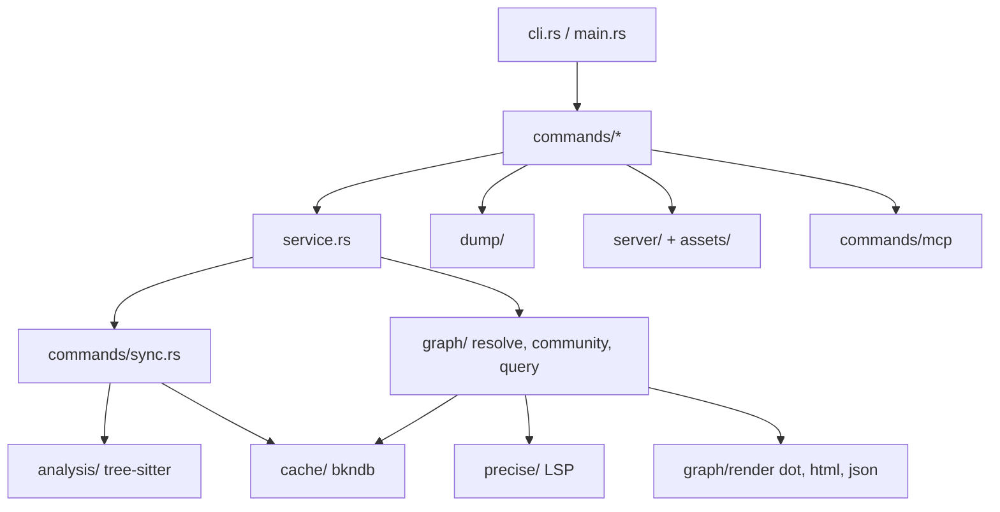

# Architecture

## System overview

`codebase-recall` (binary `code-rcl`) is a single-binary Rust CLI that analyzes a source tree and produces token-efficient context for LLMs and developers: codebase digests, impact (blast radius) reports, relation-aware context dumps, and dependency graphs. Source files are parsed with tree-sitter, stored incrementally in a per-project bkndb cache, resolved into a code graph, and rendered as markdown, JSON, DOT, or an interactive HTML viewer. The architecture is a layered, cache-then-graph pipeline; it also exposes its tools over an MCP JSON-RPC stdio server.

## Component diagram



## Data flow

1. `src/main.rs` normalizes `help` arguments, parses `Cli` (clap), and dispatches to `commands::<cmd>::run`.
2. Read-only commands call `service::auto_sync`, which runs `commands::sync::sync_cache`: it walks files (`ignore` crate), hashes content with blake3, parses only changed files via `analysis`, and writes results to the cache.
3. `graph::resolve` reads the cache and resolves references (imports, scope, types, optional precise LSP data) into edges, producing a `CodeGraph`.
4. The command renders the result: markdown digest, impact tree, path/explain output, graph (dot/html/json), or dump bundle.

`serve` builds the graph, then `server/mod.rs` serves embedded assets on 127.0.0.1 using `tiny_http`; a `/live` event stream keeps the server alive and it exits when the browser tab closes, on an authenticated POST to `/quit`, or on Ctrl-C. API requests use a per-session token, and output file access is confined to the project with filesystem capabilities.

Persistent state lives only in `<project>/.code-rcl/cache.bkndb` (plus a generated `REPORT.md`). bkndb locks that file exclusively, so one `code-rcl` process opens a project's cache at a time; code that needs the graph again while it holds a `CacheDb` (for example `sync` building its report) drops the handle first.

## Key abstractions

| Abstraction | Location | Description |
|-------------|----------|-------------|
| `ParsedFile` | `src/analysis/mod.rs` | Per-file symbols, imports, refs, scopes, bindings, string literals |
| `Language` | `src/analysis/lang.rs` | Supported language detection |
| `CodeGraph` / `Node` / `Edge` | `src/graph/mod.rs` | Resolved dependency graph with communities |
| `GraphQuery`, `SyncArgs`, `PreciseArgs` | `src/cli.rs` | Shared CLI argument groups |
| `CacheDb` | `src/cache/mod.rs` | bkndb access; table definitions in `src/cache/schema.rs`. Schemas 10–12 migrate to 13, preserving file identities/source snapshots and invalidating derived semantic indexes |
| service helpers | `src/service.rs` | Shared auto-sync and `GraphQuery` builders; use these rather than rebuilding setup in each command |

Languages analyzed: Rust, Python, JavaScript/TypeScript (including single-file components), Java, Kotlin, Go, and TOML config keys. Notebook cleanup is a dump feature; `.ipynb` is not an AST-indexed language.

## Directory structure rationale

```text
src/
  main.rs, cli.rs   entry point and clap definitions
  commands/         one module per subcommand (sync, digest, impact, graph, serve, dump, mcp, setup, ...)
  service.rs        shared sync and graph-query helpers
  analysis/         tree-sitter extraction, one module per language
  cache/            bkndb tables, queries, mutations, models
  graph/            resolve -> CodeGraph, community detection, query, render
  precise/          optional LSP clients (rust-analyzer, Pyright, JDT, kotlin-ls)
  dump/             context bundle walker and formatter
  server/           local graph viewer HTTP server
  assets/           embedded web UI (d3, graph JS/CSS, icons)
tests/              CLI integration tests and language fixtures
scripts/            codebase-recall installers
skills/             code-rcl agent skill
```

## Constraints

- Analysis is serialized within MCP, while its reader/writer handle ping and cooperative cancellation independently. `serve` uses threads and atomics.
- Edges start as AST heuristics; valid cached LSP answers override them. Requested precise failures are errors unless partial heuristic fallback is explicit. Any analysis change invalidates the project-wide precise generation.
- Errors propagate as `anyhow::Result` to `main`.

## 0.9.1 interfaces

output.rs supplies the shared JSON result envelope; operation.rs holds per-request
warnings, truncation counts, partial status, and cooperative cancellation state.
CLI text rendering remains separate. MCP schemas derive from typed inputs;
structured results and their serialized text carry the same versioned envelope.

Impact diff reconstructs tracked HEAD files in a temporary workspace and uses
baseline/current graphs to retain deleted definitions and callers. Historical
build scripts are not run; the baseline is heuristic. The user checkout and
index are not modified by this comparison.

See [MCP.md](MCP.md), [USAGE.md](USAGE.md), and [MIGRATION-0.9.md](MIGRATION-0.9.md)
for the public behavior and migration contract.

## Embedding retrieval

An optional-at-build, default-enabled local FastEmbed service owns lazily loaded
CPU models. Only explicit setup performs network I/O. Explicit embedding sync
uses parser source ranges and model tokenizer offsets to produce bounded
chunks. Each file commits its vector set and completion marker atomically after
rechecking source hash and configuration. Source mutations invalidate embeddings
in their own analysis transaction. Model/pipeline/dimension keys are independent
of transient symbol IDs and of precise graph generations.

Source sync stores each supported, in-scope file's original bytes and content hash
in `source_snapshots`, keyed by stable file ID. The snapshot and analysis rows are
committed in the same per-file transaction. Unchanged sync verifies and repairs
missing/corrupt snapshots without replacing symbols or invalidating valid vectors.
Chunking in both schedulers reads the cached snapshot, validates its identity,
hash and UTF-8, and retains the existing header/tokenization pipeline. Repo reads
before processing and commit remain freshness checks; they do not supply chunk
text. Source sync requires no embedding runtime or tokenizer. Delete removes the
file's snapshot; existing scope/ignore/size rules remain authoritative.

Schemas 10–12 migrate atomically to 13. File identities, available source
snapshots, configuration and historical metadata are preserved. Derived semantic,
content, purpose and vector tables are invalidated; normal source sync reparses
files even if their source hash is unchanged. Stale semantic generations cannot
be queried with `no_sync`. Older executables may rebuild an incompatible cache;
use the upgraded executable for sync and restart MCP after updating its binary.
`source_snapshot_read` and `source_snapshot_fill` use existing operation timings.

Chunks and float32 vectors share cache.bkndb with the AST tables. Semantic search
filters valid chunks by cached source hashes/configuration/scope and ranks exact
cosine matches; hybrid fuses declaration and semantic ranks with RRF. Per-request
metadata separates source/embedding freshness and graph resolution. The reader
continues to handle MCP ping/cancellation while the single worker runs batches.

Embedding operations have a shared observer with an atomic sidecar snapshot and
OS ownership lock independent of the cache lock. A heartbeat thread can report
native inference liveness; file transactions remain the unit of index visibility.
Parser diagnostics and analyzer revisions persist as cache metadata. Atomic
per-file embedding counters make status independent of vector decoding.
Explicit scope selection is shared by lexical/semantic/hybrid search and reports.

Length batching separates streaming chunk production, scheduling and file commits.
Up to eight staged files feed a bounded queue; length buckets schedule one native
batch, with an oldest-bucket turn every sixteenth batch. Identical pending inputs
share inference, while each logical chunk retains source metadata. Staged results
stream into a single file transaction in stable symbol/chunk order. Recovery of
owned interrupted staging runs under the operation lock, including after changing
back to file batching. Batching is operational configuration and is absent from
the embedding identity; full input text and hashes remain compatible.

The experimental compact pipeline reparses AST body ranges without changing AST
cache tables. Only bodies of independently chunked children may be delegated.
Ambiguous mappings retain the full container and report fallbacks. Optional cache
provenance marks generated container input while returned snippets remain literal
source. Profile changes require explicit rebuilding of the derived index.

## Agent integration lifecycle and CPU budget

Setup and uninstall share native target/scope resolution for Codex, Claude
Code, and Antigravity/Gemini. A version-one ownership manifest under the scope's
`.code-rcl/` tracks managed resources and shared consumers. Parsing and marker
validation happen during preflight; per-file atomic replacements preserve
unrelated settings. Uninstall retains resources needed by other owners and
unknown legacy shared consumers, and never recursively deletes user skill files.

The embedding runtime resolves `threads=0` to available logical CPUs (fallback
one) and caches sessions by model directory and effective CPU budget. The same
budget applies to indexing and queries. It does not become part of chunk/vector
identity, and does not change source freshness or commit/cancellation rules.

The canvas renderer shares one active node for hover/selection, preserves kind
and subsystem colors, and dims unrelated nodes to grey. Red outgoing and blue
incoming edges keep source-to-target arrow direction. Reciprocal edges use
separate lanes shared with hit-testing; node layout and backend graph data stay
unchanged. Inline HTML and the server use the same assets.


Selective LSP verification is opt-in: `sync --precise-selective` (MCP
`precise_selective: true`). See [selective precise mode](PRECISE-SELECTIVE.md) for coverage, backend setup, deadlines and cache recovery.
